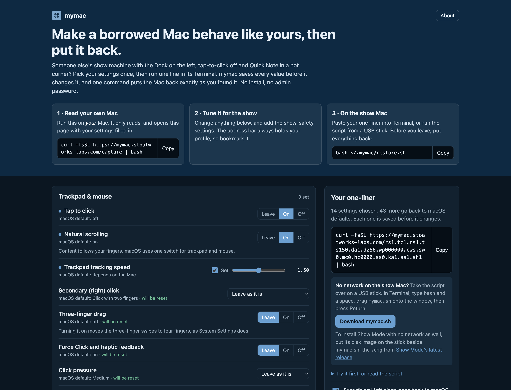

# mymac

> **AI-assisted project.** This codebase was created with [Claude](https://claude.com/claude-code)
> (Anthropic), directed and reviewed by a human author.
> **Live at [mymac.stoatworks-labs.com](https://mymac.stoatworks-labs.com). Tested in a macOS 26.5
> VM, not yet on a real show machine.** In the VM, a full apply and then restore put back all 107
> preference keys mymac can touch exactly, and the wallpaper store came back byte-for-byte. Not
> confirmed yet: how trackpad changes feel live on real hardware (the VM has no trackpad), and how
> Terminal.app's own permissions behave. Pointer size and the System Events settings may ask, or
> be refused (see [Limits](#limits)).

Walk up to someone else's show Mac and it's set up wrong. The Dock is on the left and magnified,
tap-to-click is off, scrolling runs backwards, Quick Note lives in the bottom-right hot corner,
and clicking the desktop sweeps Keynote off the projector. mymac gives you a one-line command
that makes that Mac behave like yours, and a second one that puts every setting back before you
leave.

```bash
curl -fsSL https://mymac.stoatworks-labs.com/rs1.tc1.ts150.da1.dz56.cws.sw0.hc0000 | bash
```

```bash
bash ~/.mymac/restore.sh
```

No install, no admin password, nothing stored anywhere. The profile lives entirely in the link.



## How to use it

1. **Read your own Mac.** On *your* Mac, run
   `curl -fsSL https://mymac.stoatworks-labs.com/capture | bash`. It only reads your settings,
   then opens the builder with them filled in.
2. **Tune it for the show.** Change anything, add the show-safety settings (or **Add show-safe
   pack**), and bookmark the page: the address bar always holds your profile.
3. **On the show Mac,** paste the one-liner into Terminal. Before you leave, run
   `bash ~/.mymac/restore.sh`.

To see what would change without changing anything:

```bash
curl -fsSL https://mymac.stoatworks-labs.com/<code> | bash -s -- --dry-run
```

No network on the show Mac? Use **Download mymac.sh** on the builder, take the file across, and
run it with `bash mymac.sh`. Running it through `bash` means Gatekeeper's quarantine never comes
into it.

## What it does to the Mac

Every change goes through one of a few shell functions. Each reads the key's current value and
type first and writes a line to `~/.mymac/restore.sh` that puts it back, then writes the new value.

- A key that was unset is deleted again on restore. A key holding a list or dictionary is never
  touched.
- A value that's already right isn't written at all, so restore doesn't touch it either.
- Run apply a second time (with the same or a different code) and the **first** snapshot is kept.
  Restore always goes back to how the Mac was before mymac, never to your previous run.
- The wallpaper is saved two ways: a copy of WallpaperAgent's store (macOS 14 and later; this
  brings back dynamic and aerial wallpapers and every Space), and each screen's image path as a
  fallback.
- "Keep awake" runs `caffeinate` in the background; restore stops it.
- After applying, mymac restarts only what it has to: the Dock, Finder, WindowManager or Control
  Centre, plus `activateSettings -u` to push trackpad and keyboard changes to the driver. Don't
  run it in the middle of a show.
- Restore puts everything back, restarts the same things, and deletes `~/.mymac`, so no trace
  is left on the Mac.

The script refuses to run under `sudo` (that would change root's settings, not the user's) and
is wrapped in `main()`, so a download cut off half way runs nothing at all.

**Everything I left alone goes back to macOS defaults** (`rs1` in the code) is for a Mac that's
been set up strangely. Every setting you didn't choose goes back to the macOS default. Where
macOS's built-in value depends on the Mac (tracking speed, Dock size, key repeat), the key is
deleted so macOS falls back to its own value. Only keys that hold a value are rewritten. The
show-safety settings are never reset this way: resetting them would mean, for example, putting
Quick Note back in a hot corner.

## The code

A profile is a list of two-letter setting codes, each followed by a value, joined with dots:
`rs1.tc1.dpl.hc000e`. Values only use letters and digits, so a code never needs quoting in a
shell or escaping in a URL. The same address gives the script to `curl` or `wget` and the builder
page to a browser. Add `.sh` to get the script whatever is asking.

| Code | Setting | Values | Reset to default |
|---|---|---|---|
| `rs` | Everything not listed goes back to macOS defaults | 1 | |
| `tc` | Tap to click | 1 on, 0 off | yes |
| `ns` | Natural scrolling (trackpad and mouse share it) | 1 on, 0 off | yes |
| `ts` | Trackpad tracking speed | 0–300 (×0.01) | yes |
| `rc` | Secondary click | f two fingers, r bottom-right corner, l bottom-left corner, o off | yes |
| `td` | Three-finger drag (moves the three-finger swipes to four) | 1 on, 0 off | yes |
| `fc` | Force Click and haptic feedback | 1 on, 0 off | yes |
| `cp` | Click pressure | 0 light, 1 medium, 2 firm | yes |
| `ms` | Mouse tracking speed | 0–300 (×0.01) | yes |
| `cs` | Pointer size | 100–400 (×0.01) | yes |
| `sk` | Shake pointer to find it | 1 on, 0 off | yes |
| `dp` | Dock position | l left, b bottom, r right | yes |
| `da` | Dock auto-hide | 1 on, 0 off | yes |
| `di` | Hidden Dock appears instantly | 1 on, 0 off | yes |
| `dz` | Dock size | 16–128 pt | yes |
| `dm` | Dock magnification | 1 on, 0 off | yes |
| `dl` | Magnified size | 16–128 pt | yes |
| `dr` | Suggested and recent apps in the Dock | 1 on, 0 off | yes |
| `de` | Minimise effect | g genie, s scale | yes |
| `dw` | Minimise into app icon | 1 on, 0 off | yes |
| `dx` | Show only open apps | 1 on, 0 off | yes |
| `db` | Animate opening apps | 1 on, 0 off | yes |
| `dn` | Indicators for open apps | 1 on, 0 off | yes |
| `mh` | Auto-hide the menu bar | 1 on, 0 off | yes |
| `ck` | Clock shows seconds | 1 on, 0 off | yes |
| `hr` | Time format | 1 24-hour, 0 12-hour | yes (follows region) |
| `wp` | Wallpaper colour, every screen | rrggbb | no |
| `ap` | Appearance | l light, d dark | yes |
| `sb` | Show scroll bars | a automatically, s when scrolling, l always | yes |
| `kr` | Key repeat rate | 2 6 12 30 60 120 (fastest to slowest) | yes |
| `kd` | Delay until repeat | 15 25 35 68 94 120 (shortest to longest) | yes |
| `ph` | Hold a key for accents (off: hold to repeat) | 1 on, 0 off | yes |
| `fn` | F1, F2… as standard function keys | 1 on, 0 off | yes |
| `ac` | Correct spelling automatically | 1 on, 0 off | yes |
| `ak` | Capitalise words automatically | 1 on, 0 off | yes |
| `sq` | Smart quotes and dashes | 1 on, 0 off | yes |
| `pd` | Full stop with double-space | 1 on, 0 off | yes |
| `dk` | Icons on the desktop | 1 on, 0 off | yes |
| `ex` | All filename extensions | 1 on, 0 off | yes |
| `hf` | Hidden files | 1 on, 0 off | yes |
| `pb` | Finder path bar | 1 on, 0 off | yes |
| `su` | Finder status bar | 1 on, 0 off | yes |
| `fv` | New Finder windows use | i icons, n list, c columns, g gallery | yes |
| `cw` | Click wallpaper to reveal desktop | a always, s only in Stage Manager | yes |
| `sm` | Stage Manager | 1 on, 0 off | yes |
| `tg` | Tile windows by dragging to screen edges | 1 on, 0 off | yes |
| `mr` | Rearrange Spaces by most recent use | 1 on, 0 off | yes |
| `sp` | Displays have separate Spaces (log out to apply) | 1 on, 0 off | yes |
| `sw` | Swipe between full-screen apps | 1 on, 0 off | yes |
| `mc` | Swipe for Mission Control and App Exposé | 1 on, 0 off | yes |
| `nc` | Swipe from the right edge for Notification Centre | 1 on, 0 off | yes |
| `lp` | Pinch for Apps, spread for desktop | 1 on, 0 off | yes |
| `bk` | Two-finger swipe back and forward in browsers | 1 on, 0 off | yes |
| `hc` | Hot corners: top-left, top-right, bottom-left, bottom-right | four of 0 nothing, 2 Mission Control, 3 app windows, 4 desktop, 5/6 start/disable screen saver, a display sleep, b Launchpad, c Notification Centre, d lock screen, e Quick Note | no |
| `ss` | Start screen saver after | 0 never, 5, 10, 20, 60 minutes | no |
| `ka` | Keep the Mac and displays awake until restore | 1 | no |
| `as` | Silence alert and interface sounds | 1 | no |
| `ar` | AirPlay Receiver | 1 on, 0 off | no |
| `cn` | Crash reports go to Notification Centre, not a window | 1 | no |

The settings are data in [`public/lib/catalogue.js`](public/lib/catalogue.js): the keys, their
types, the macOS default, how capture reads them back, and what has to restart. Several keys and
behaviours (swipes via `activateSettings`, the wallpaper store, AirPlay Receiver's spelling on
macOS 26, `UseUNC`) were taken from [Show Mode](https://github.com/stoatworks-labs/showmode),
which proved them on macOS 26.4.1.

## Limits

- **Pointer size** is in a domain macOS protects. If Terminal is refused, the run marks it ✗ and
  says to set it in System Settings › Accessibility › Display. It may also need a logout to show.
- **Menu bar auto-hide and appearance** go through System Events, so macOS asks once to let
  Terminal control it. Say no and those two are marked ✗; everything else still applies.
- **Some changes need a logout** to take full effect (pointer size, shake to find, separate
  Spaces). **Some apply as apps reopen** (keyboard repeat, smart quotes, scroll bars). The run
  lists both.
- **The wallpaper** is set on every screen's current Space. Restore brings back all of them.
- **Out of a script's reach:** Do Not Disturb, display arrangement and mirroring, and the sound
  output device. Each run ends with a reminder to check them. For show-long guards (the cursor
  fence, display lock, Do Not Disturb, muting other apps), use
  [Show Mode](https://github.com/stoatworks-labs/showmode). That's an app you install, where mymac
  is for a Mac that isn't yours.

## Privacy

The site is a static page and a Cloudflare Worker that turns the code in the URL into a script.
It keeps no database and no logs of its own, and has no accounts. Nothing on the show Mac is sent
anywhere: capture prints a link on the Mac it runs on, and apply only writes local preferences.

## Development

```bash
npm test          # unit tests + a sandboxed apply/restore round trip (macOS)
npx wrangler dev  # http://localhost:8787
```

There's no build step: `public/` is served as-is, and the Worker (`src/worker.js`) imports the
same modules the page uses. `test/roundtrip.test.mjs` runs the generated scripts for real against
stand-ins for `defaults`, `osascript`, `killall`, `activateSettings` and `caffeinate`
(`test/shims/`). The stand-ins act on copies of the preference files, seeded by exporting this
Mac's real domains, so the tests read your settings but never change them. They check that apply
then restore gives back identical plists, and that capture reads back exactly what apply wrote.

A push to `main` deploys the site through `.github/workflows/deploy.yml`. It runs the tests on a
macOS runner (so the round trip runs for real), smoke-checks the page, deploys with wrangler, and
then checks the live page and the scripts the Worker serves are this commit's.

To try it on a real macOS without touching your own, use a throwaway
[tart](https://tart.run) VM: `tart clone ghcr.io/cirruslabs/macos-tahoe-base:latest mymac-test`.
`test/gen.mjs` writes the scripts and `test/gen-dumpkeys.mjs` writes a script that dumps every key
mymac can touch. Run them in the VM's GUI session with
`sudo launchctl asuser 501 sudo -H -u admin bash …`.

## Licence

MIT. See [LICENSE](LICENSE).
